<div align="center">


**基于大数据智能推荐的陌生人社交平台**

即时通讯 · 动态圈子 · 附近的人 · 探花匹配 · 智能推荐 · VIP 权益 · 内容安全


</div>

<br/>

<p align="center">一个账号，连接真实附近的 TA · 开源可自托管</p>

---

## 目录

- [核心亮点](#核心亮点)
- [数字说话](#数字说话)
- [产品功能预览](#产品功能预览)
- [技术亮点总览](#技术亮点总览)
  - [后端技术栈](#后端技术栈)
  - [前端矩阵](#前端矩阵)
- [内容安全全景](#内容安全全景)
- [推荐引擎](#推荐引擎)
- [系统架构](#系统架构)
- [安全设计矩阵](#安全设计矩阵)
- [部署运维](#部署运维)
- [项目结构](#项目结构)
- [环境变量](#环境变量)
- [快速启动](#快速启动)
- [监控与可观测](#监控与可观测)
- [路线图](#路线图)
- [文档](#文档)
- [贡献指南](#贡献指南)

---

<a id="核心亮点"></a>
## 核心亮点

> 覆盖陌生人社交从相识、沟通到安全合规的八大核心能力。

<table>
  <tr>
    <td align="center" width="33%"><b>探花匹配</b><br/><span>左滑跳过 · 右滑喜欢 · 超级喜欢<br/>互喜即弹「It's a Match!」全屏庆祝层</span></td>
    <td align="center" width="33%"><b>即时通讯</b><br/><span>WuKongIM 自托管长连接 + LiveKit 1v1 音视频<br/>零商业授权费 · 连接数无上限</span></td>
    <td align="center" width="33%"><b>AI 智能推荐</b><br/><span>5 层召回漏斗 + 双塔向量召回<br/>+ Neo4j 二度好友关系</span></td>
  </tr>
  <tr>
    <td align="center" width="33%"><b>内容安全</b><br/><span>文本 DFA 敏感词 + 图视先发后审<br/>三级定级 · 词库热刷新</span></td>
    <td align="center" width="33%"><b>附近的人</b><br/><span>Elasticsearch Geo 500km 精准召回<br/>响应 &lt;50ms</span></td>
    <td align="center" width="33%"><b>一套代码 12 端</b><br/><span>H5 / App / 微信·抖音·支付宝等小程序<br/>/ 鸿蒙 / 快应用</span></td>
  </tr>
  <tr>
    <td align="center" width="33%"><b>VIP 权益闭环</b><br/><span>会员套餐 + 支付订单<br/>+ 收入统计一体化</span></td>
    <td align="center" width="33%"><b>沉浸式短视频</b><br/><span>抖音式上下滑视频流<br/>+ 一键发布</span></td>
    <td align="center" width="33%"><b>审核工作台</b><br/><span>快捷键 A 通过 / R 驳回<br/>人工联动自动下架</span></td>
  </tr>
</table>

---

<a id="数字说话"></a>
## 数字说话

<table>
  <tr>
    <td align="center"><h2>12</h2>微服务模块</td>
    <td align="center"><h2>12</h2>端统一输出</td>
    <td align="center"><h2>12</h2>中间件技术栈</td>
    <td align="center"><h2>6</h2>核心域服务<br/><sub><code>recommend</code> / <code>elasticsearch</code> 按能力组件另计，早期文档曾以 8 计</sub></td>
  </tr>
  <tr>
    <td align="center"><h2>5 层</h2>推荐召回漏斗</td>
    <td align="center"><h2>64 维</h2>用户 Embedding</td>
    <td align="center"><h2>&lt;50ms</h2>地理召回延迟</td>
    <td align="center"><h2>¥0</h2>IM / 音视频授权费</td>
  </tr>
</table>

---

<a id="产品功能预览"></a>
## 产品功能预览

> 以下截图均取自**真实运行环境**（移动端 H5 + 运营后台），覆盖 C 端核心链路与后台管理矩阵，非设计稿。

### 心飞交友 · 移动端 App（uni-app · 多端）

<p align="center">
  
  <br/>
  <sub>移动端 H5 实录：匹配首页 → 圈子 / 视频 / 我的 → 回到首页</sub>
</p>

<table>
  <tr>
    <td align="center">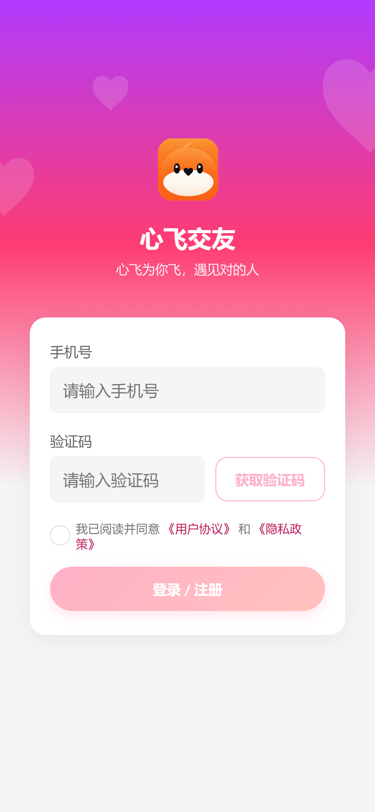<br/><b>登录注册</b><br/>手机号 + 验证码一键登录</td>
    <td align="center"><br/><b>探花匹配</b><br/>左滑跳过 · 右滑喜欢 · 超级喜欢</td>
    <td align="center">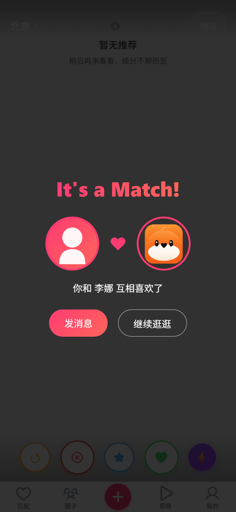<br/><b>配对成功</b><br/>互喜弹「It's a Match!」庆祝层</td>
  </tr>
  <tr>
    <td align="center">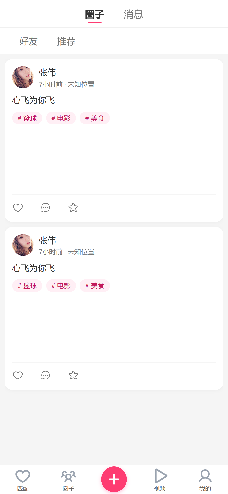<br/><b>圈子动态</b><br/>好友 / 推荐双 Tab 动态流</td>
    <td align="center"><br/><b>发布内容</b><br/>图文 / 视频 + 话题 / 位置</td>
    <td align="center"><br/><b>短视频</b><br/>抖音式沉浸式视频流</td>
  </tr>
  <tr>
    <td align="center" colspan="3">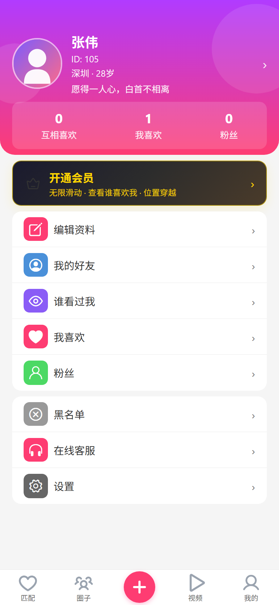<br/><b>我的 · 个人中心</b><br/>会员权益 · 好友 · 谁看过我</td>
  </tr>
</table>

> **配对成功庆祝层**：当双方互相喜欢时，App 会弹出 **「配对成功 / It's a Match!」** 全屏庆祝层，并自动建立 IM 好友关系、推送匹配通知、IM 实时透传匹配消息。上图「配对成功」即为该庆祝层的真实渲染（对方头像为占位示意，右侧为 App 品牌图标）。

### 心飞交友 · 运营后台管理系统（Vue3 + Element Plus + ECharts）

<table>
  <tr>
    <td align="center">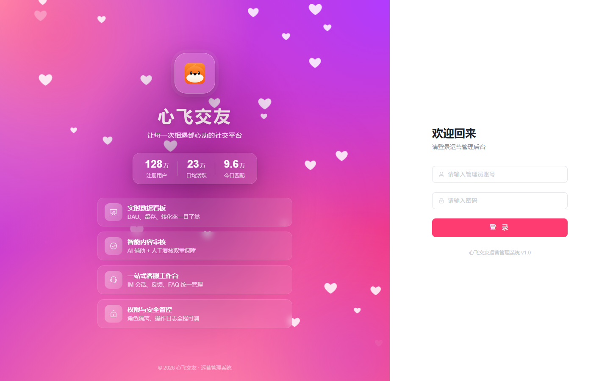<br/><b>后台登录页</b><br/>账号 + 密码登录（DEV 环境标识）</td>
    <td align="center">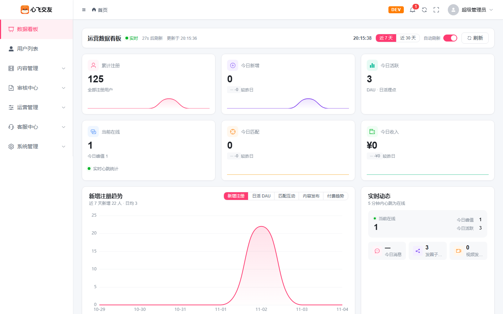<br/><b>数据看板</b><br/>运营总览 + 趋势图 + 实时动态</td>
  </tr>
  <tr>
    <td align="center">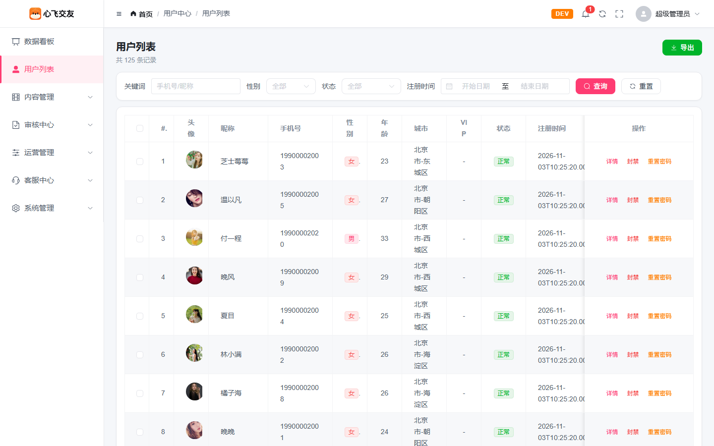<br/><b>用户管理</b><br/>125+ 用户 · 封禁 / 重置密码 / 导出</td>
    <td align="center">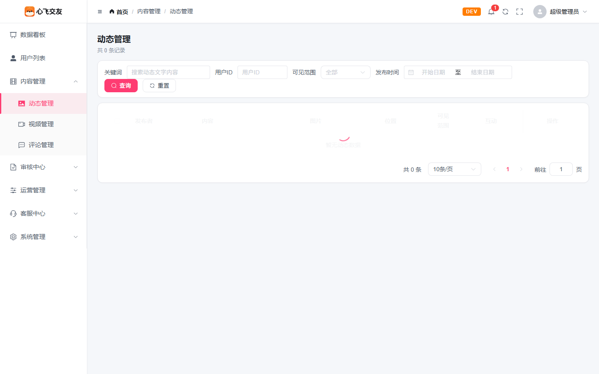<br/><b>动态管理</b><br/>动态 CRUD + 图片 / 视频</td>
  </tr>
  <tr>
    <td align="center">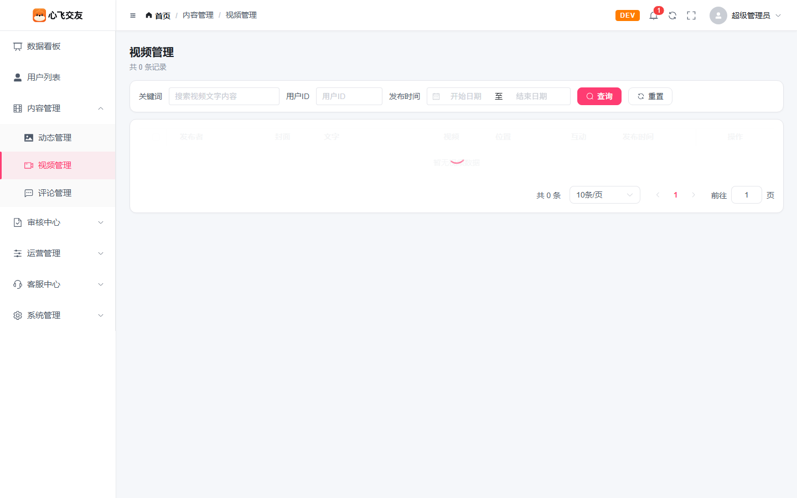<br/><b>视频管理</b><br/>小视频审核 / 下架</td>
    <td align="center">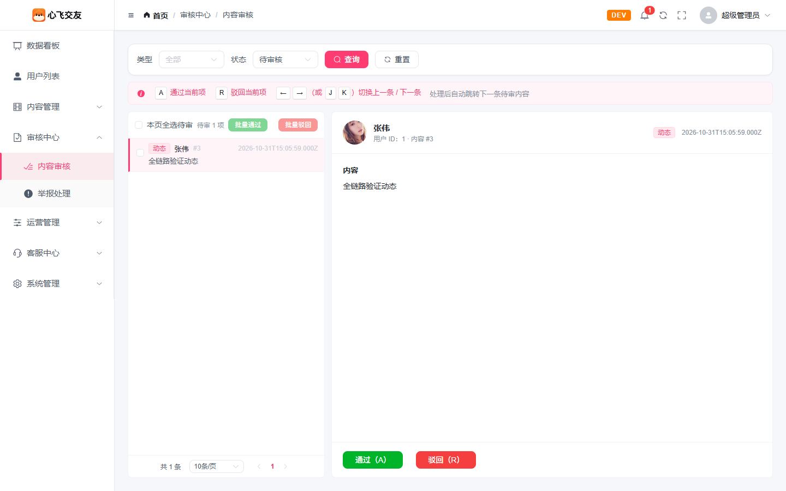<br/><b>内容审核</b><br/>审核工作台（A 通过 / R 驳回 快捷键）</td>
  </tr>
  <tr>
    <td align="center">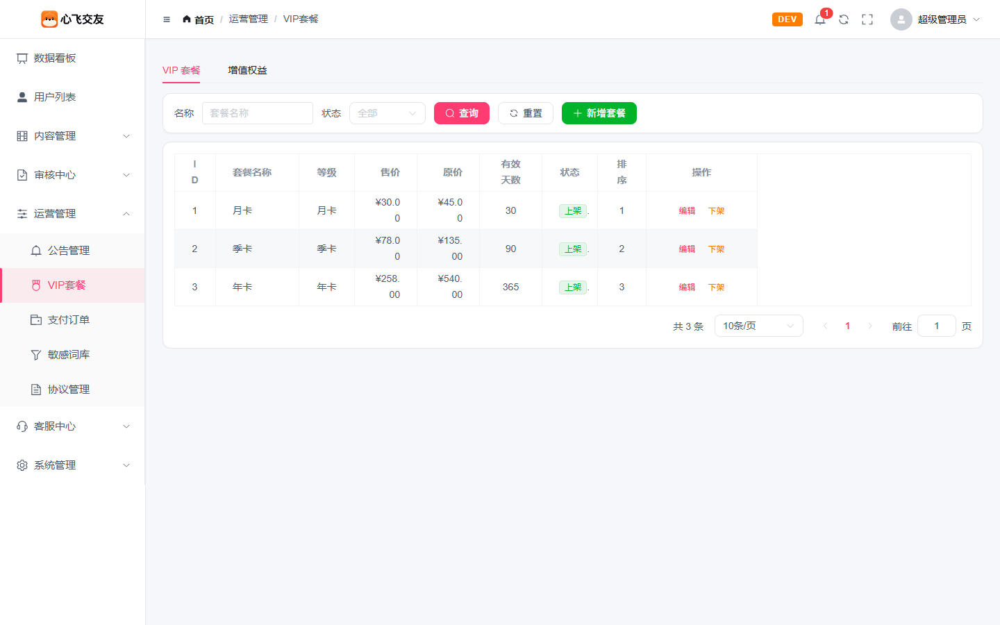<br/><b>VIP 套餐</b><br/>会员权益配置</td>
    <td align="center">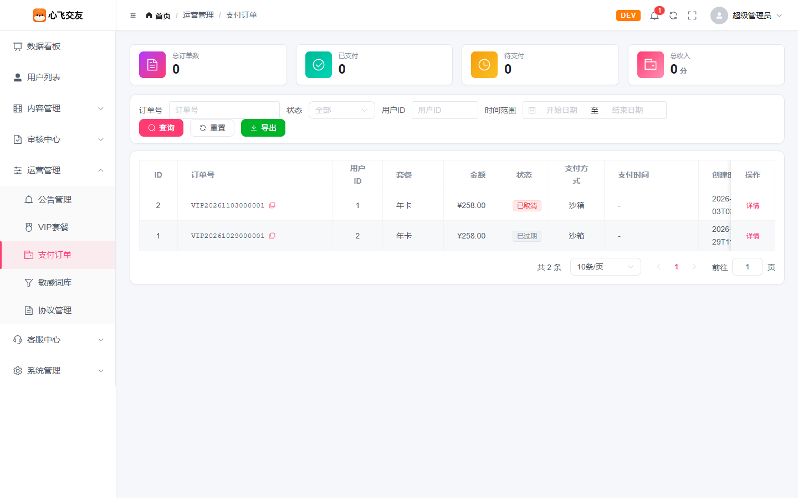<br/><b>支付订单</b><br/>订单 / 收入统计</td>
  </tr>
  <tr>
    <td align="center">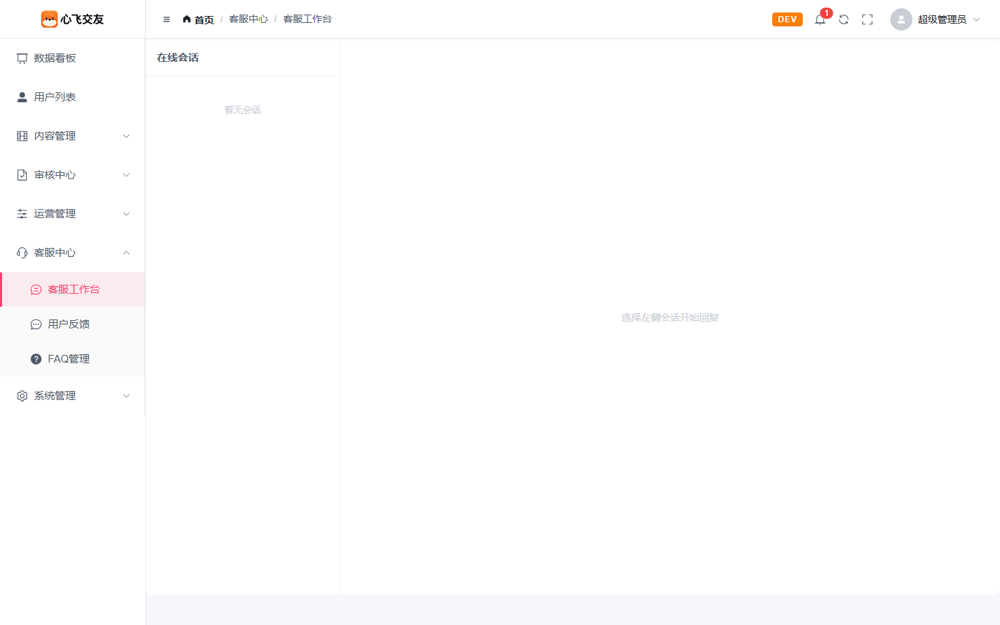<br/><b>客服工作台</b><br/>IM 会话 + 反馈 + FAQ</td>
    <td align="center">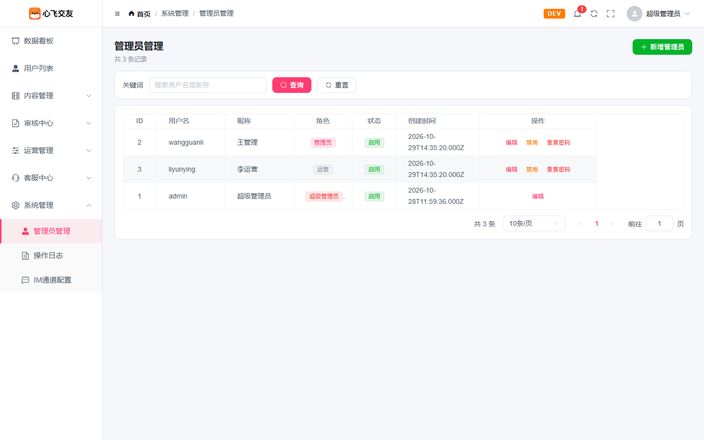<br/><b>系统管理</b><br/>管理员 / 日志 / IM 通道</td>
  </tr>
</table>

---

<a id="技术亮点总览"></a>
## 技术亮点总览

<a id="后端技术栈"></a>
### 后端技术栈

| 领域 | 技术选型 | 核心优势 |
|------|----------|----------|
| **后端框架** | Spring Boot 4.1.1 + JDK 25 + Spring Cloud 2025.1 | 当前主线版本，JVM 性能与 GC 表现改善，`jakarta.*` 命名空间标准化 |
| **微服务生态** | Spring Cloud Alibaba 2025.1（Nacos 3.0.0 服务发现，未启用配置中心） | 服务注册/发现由 Nacos 承担，配置集中在各模块本地 `application.yml`，便于小团队运维 |
| **服务网关** | Spring Cloud Gateway（WebFlux 版，`spring-cloud-starter-gateway-server-webflux`） | 响应式非阻塞，限流/跨域/路由统一收口，唯一对外端口 8090 |
| **认证鉴权** | Sa-Token 1.46.0（spring-boot4-starter；Redis 会话存储仅 sso 引入） | 用于登录态与 Token 签发/校验（`StpUtil.login/logout/getLoginIdByToken`），业务鉴权由自研拦截器链（`TokenInterceptor`、`AdminTokenInterceptor`、`XInternalTokenInterceptor`）实现 |
| **持久层** | MyBatis-Plus 3.5.17 (spring-boot4-starter) + MySQL 8.0 | JDK 25/SB4 适配，CRUD 提效 50%，**`@LoadBalanced` 替代硬编码** |
| **文档数据库** | MongoDB 7（compose `mongo:7`）+ spring-data-mongodb (SB4 托管) | 动态/评论/消息/行为日志**灵活 Schema**，水平扩展友好 |
| **搜索引擎** | Elasticsearch 9.4.5 + spring-data-elasticsearch | **Elastic Geo 精准地理检索**，附近的人 <50ms，替代 MySQL geo 函数 |
| **缓存** | Redis 7（compose `redis:7-alpine`）+ Spring Cache + Lettuce | 会话 + 缓存 + 网关限流计数 + 用户级风控计数 |
| **消息队列** | RocketMQ 5.3.1 (rocketmq-spring-boot-starter 2.3.6) | 行为评分异步解耦（circle/video 生产、recommend 消费），削峰填谷 |
| **对象存储** | MinIO (S3 兼容) | 可本地可上云，**视频/图片上传成本降低 90%**（vs 阿里云 OSS） |
| **即时通讯** | WuKongIM（开源 Apache-2.0, 自托管 WS 长连接） + LiveKit SFU（WebRTC 1v1） | **商业 SDK 全替换**，无授权费，连接数与消息存储可扩展 |
| **向量数据库** | Qdrant（纯 REST，point id = userId 免映射） | 双塔 embedding **召回友互惠加分**，fallback 零损失降级 |
| **图数据库** | Neo4j 5.x（Bolt 协议原生驱动） | **二度好友共同喜欢数**排序召回，社交扩展场景核心 |
| **AI 模型** | PyTorch 双塔（权重共享 + BPR Loss + L2 归一化） | **特征自动工程**（64 维 Embedding，可 `--mock`），全流程国产化 |
| **密码安全** | spring-security-crypto (BCrypt，默认强度 10) | 密码哈希替代 MD5，盐值内置于哈希串 |
| **服务发现** | `@LoadBalanced RestClient.Builder` | 通过 `lb://` 服务名做负载均衡（`HttpServiceProxyConfig`） |
| **限流** | Gateway IP 限流（`RateLimitGlobalFilter`，Redis 计数，5 次/60s）+ 服务内用户级风控（`RiskControlService`，Redis 固定窗口） | **双层防线**：网关 IP + 用户 ID 双重频率保护 |
| **监控** | Spring Boot Actuator + Micrometer（仅 server 模块引入） | 暴露 `health / info / metrics` 三类端点，贴合 K8s 健康探针 |
| **代码质量** | Lombok + commons-io/commons-lang3 + 全局 Result 异常体系 | 模板代码 -30%，统一业务异常，全局异常兜底 |
| **部署运维** | Git Tag 语义版本 + Gitea Actions | **一键回滚** + 增量编译，增量部署 10 秒级完成 |
| **敏感词引擎** | houbb/sensitive-word（DFA 自动机 + 多音字/繁简/字符混淆变体） | 三级定级（直接拒绝 / 星号替换 / 进人工队列），词库变更热刷新 |

<a id="前端矩阵"></a>
### 前端矩阵

| 项目 | 框架栈 | 核心优势 |
|------|--------|----------|
| **xfjy-app** | uni-app + Vue 3.5 + Pinia + Sass | 一套代码输出 12 端（H5 + App + 微信/支付宝/抖音/QQ/百度/快手/飞书/小红书/京东/微信小程序 + 鸿蒙 + 快应用） |
| **xfjy-admin** | Vue 3.5 + TypeScript + Element Plus 2.14 + ECharts 6 + Vite 8 + Pinia | 热更新 50ms，Element Plus 开箱即用，TS 全类型安全 |
| **WuKongIM SDK** | 独立 JS SDK（uni-app 集成） | 前后端 IM 共用同一 SDK，离线消息 / 历史 / 漫游全支持 |

---

<a id="内容安全全景"></a>
## 内容安全全景

> 内容安全不是项目副产品，而是核心架构层。

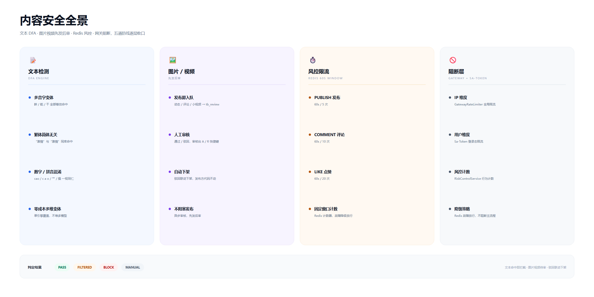

---

<a id="推荐引擎"></a>
## 推荐引擎（5 层漏斗）

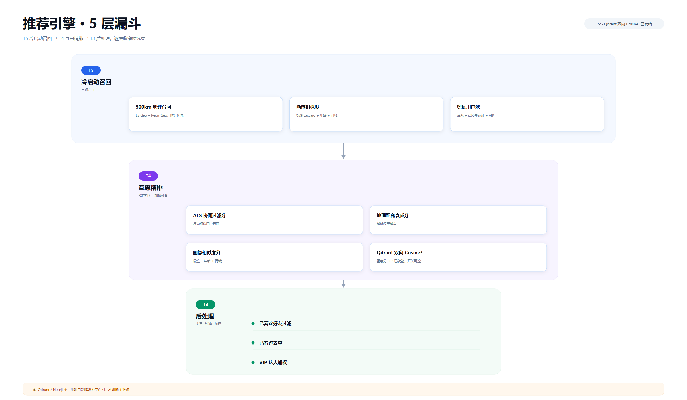

### AI 双塔训练管线

| 阶段 | 工具 | 产出 |
|------|------|------|
| 特征工程 | Python + MongoDB 用户行为日志 | (user, liked_user, score) 三元组 |
| 模型训练 | PyTorch 权重共享对称双塔 + BPR Loss | 64 维 L2 归一化 User Embedding |
| 权重导出 | `torch.onnx` + numpy 序列 | float32 向量文件 |
| 在线落地 | Qdrant `PUT /points` upsert | pointId=userId 免映射检索 |
| 离线验证 | `--mock` 模式无依赖跑通管线 | 一键验证训练 + 召回链路完整性 |

> 状态说明：训练与权重导出管线已就绪；Qdrant 向量召回由 `xfjy.qdrant.enabled` 开关控制，当前默认关闭，在线候选仍由既有召回链路产出。开启前需完成向量灌库与灰度验证。

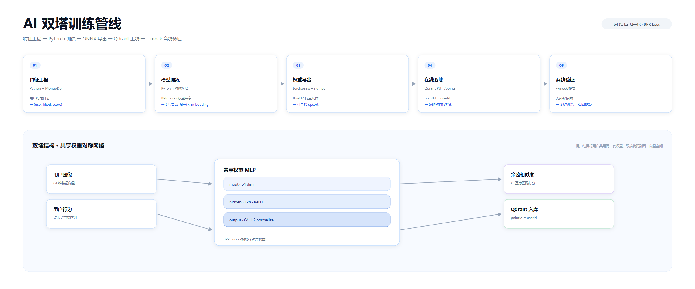

---

<a id="系统架构"></a>
## 系统架构

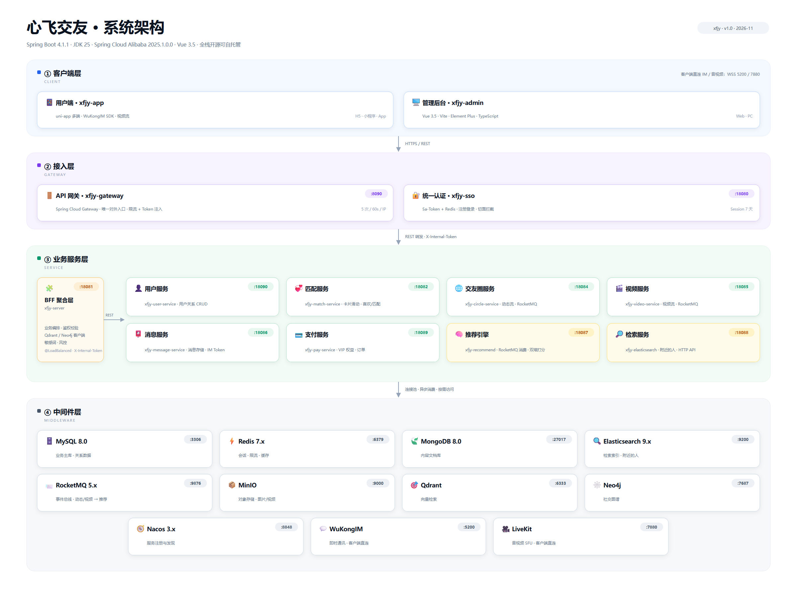

> 架构图源文件为 `docs/diagrams/architecture.svg`（矢量稿，可直接编辑），改完导出 2400px 宽 PNG 覆盖 `architecture.png`；`architecture.mmd` 仅作结构速查，不再用于出图。内容安全、推荐漏斗、双塔三张业务图同源同法（对应 `content-safety` / `recommend-funnel` / `recommend-twin-tower`）。

---

<a id="安全设计矩阵"></a>
## 安全设计矩阵

| 层 | 机制 | 工具 |
|----|------|------|
| **网络边界** | TLS 终止于 Nginx + 仅 8090 对外 | docker-compose 移除域服务端口映射 |
| **域服务鉴权** | X-Internal-Token（Gateway 注入 + server 调用域服务时注入） | `InternalTokenFilter` / `HttpServiceProxyConfig` 注入，6 个域服务用 `XInternalTokenInterceptor` + `@Value` 校验 |
| **API 限流** | IP 维度 + 用户维度 | `RateLimitGlobalFilter`（Redis）+ `RiskControlService`（Redis） |
| **用户风控** | Redis 固定窗口 60s 计数器 | RiskControlService |
| **内容合规** | 文本 DFA + 图片/视频先发后审 | houbb sensitive-word + tb_review |
| **恶意注册** | 设备指纹（Redis Set）+ Redis 计数 | 注册防刷 |
| **密码存储** | BCrypt（默认强度 10） | spring-security-crypto |
| **SQL 注入** | MyBatis 参数化查询 + @Select 注解 | MyBatis-Plus |
| **XSS 防御** | 全局 Result DTO + Jackson Escape | Spring WebMvc |
| **审计日志** | GMT 时间戳 + 请求链路 | Filter + SLF4J（logback） |

---

<a id="部署运维"></a>
## 部署运维

### 服务端口（开发/测试环境）

> `deploy/docker-compose.app.yml` 当前为内网开发/测试编排：**所有服务端口都映射到宿主机并放行防火墙**；
> 生产部署应收敛为仅 8090 对外（域服务只走容器网络）。

| 服务 | :Port | 宿主映射 | 职责 |
|------|-------|----------|------|
| xfjy-gateway | :8090 | ✅ `8090:8090` 对外 | 路由 + 限流 + 跨域 + InternalToken 透传 |
| xfjy-sso | :18080 | ⚠ 内网放行 | Sa-Token 认证 |
| xfjy-server | :18081 | ⚠ 内网放行 | BFF 编排 + 推荐评分 + Qdrant + Neo4j |
| xfjy-user-service | :18090 | ⚠ 内网放行 | 用户关系 CRUD |
| xfjy-match-service | :18082 | ⚠ 内网放行 | 探花匹配评分 |
| xfjy-circle-service | :18084 | ⚠ 内网放行 | 圈子动态发布 → RocketMQ |
| xfjy-video-service | :18085 | ⚠ 内网放行 | 小视频流 → RocketMQ |
| xfjy-message-service | :18086 | ⚠ 内网放行 | WuKongIM Token + LiveKit Token |
| xfjy-pay-service | :18089 | ⚠ 内网放行 | VIP 权益 CRUD |
| xfjy-recommend | :18087 | ⚠ 内网放行（未走网关） | MQ 消费者 + 推荐评分 |
| xfjy-elasticsearch | :18088 | ⚠ 内网放行（未走网关） | ES HTTP 检索接口 |

### CI/CD 流水线

> 平台基线（2026-11-02 升级）：**Gitea 28.3.0 + Gitea Runner 5.2.4**，Docker 部署于 192.168.20.133（compose 见 `deploy/docker-compose.gitea.yml`）；Actions 历史运行记录设为永久保留（`RUN_RETENTION_DAYS=0`）。
>
> ⚠️ **Runner 5.x 必须关闭 `container.sweep`**：5.x 起每个 job 经 docker socket proxy 创建容器，job 结束默认按 label 强删这些容器（`sweep` 不设即为 true）。本项目 job 用 `docker compose` 部署的是**常驻微服务**，不关闭会在部署收尾把 11 个后端容器全部误删（2026-11-02 run#119 事故）。`deploy/gitea/config.yaml` 已固定 `container.sweep: false`（官方说明：jobs deploy services to the runner Docker daemon 时必须关），改动后需 `docker compose -f deploy/docker-compose.gitea.yml restart runner` 生效。

手动运行（Actions → Run workflow）的输入项全部为**下拉选择**：

- 动作（deploy 工作流）：`deploy` / `build` / `start` / `stop` / `restart` / `status` / `logs`
- 运维（ops 工作流）：`status` / `stop` / `restart` / `logs` / `rollback`
- 目标：`auto`（按变更自动推断）/ `all` / `backend`（11 个后端）/ `app`（H5）/ `admin` / 单个微服务

| 动作 | 触发方式 | 行为 |
|------|----------|------|
| `deploy` | push master / 手动 | 增量编译 + 镜像构建 + `--build --force-recreate` |
| `build` | 手动 | 仅构建镜像，不重启容器 |
| `start / stop / restart` | 手动 | 容器生命周期（自动跳过编译） |
| `status / logs` | 手动 | 运维观测 |
| `rollback`（ops 工作流） | 手动 | 回滚到上一个成功版本或指定 tag |

### 镜像版本管理（**Git Tag = 语义版本**）

```bash
# 推送 tag → 自动打版本
git tag v1.2.3 && git push origin --tags
# → xfjy/xfjy-server:v1.2.3（精确回滚）

# 推分支 → 打 commit 标记
git push origin master
# → xfjy/xfjy-server:master-a1b2c3d

# 本地部署 → 自动从 git 获取
./manage.sh deploy
# → IMAGE_TAG=v1.2.3 或 commit hash 自动
```

| 输入参数 | 说明 |
|----------|------|
| `target` | 下拉选择部署/操作目标（auto/all/backend/app/admin/单个微服务） |
| `skip_ci` | 跳过编译，仅用现有产物（start/stop/restart/status/logs 自动跳过） |
| `full_build` | 强制全量 mvn rebuild，忽略增量判定 |

---

<a id="项目结构"></a>
## 项目结构

```
xfjy/
├── pom.xml                     # 根 pom：SB 4.1.1 parent + 依赖版本集中管理
│
├── xfjy-gateway/               # 统一入口网关（:8090）
│   └── filter/                 #   ├── RateLimitGlobalFilter（IP 限流）
│                               #   └── InternalTokenFilter（Token 透传）
│
├── xfjy-server/                # 主聚合服务（:18081，BFF）
│   ├── vector/                 #   ├── QdrantClient（向量 upsert + topK）
│   ├── graph/                  #   └── Neo4jClient（好友度 + 二度推荐）
│   ├── interceptor/            #   └── AdminTokenInterceptor
│   ├── config/
│   │   ├── SaTokenConfigure   #   └── SSO 鉴权过滤链
│   │   └── HttpServiceProxyConfig # @LoadBalanced 域服务路由
│   ├── exception/              #   ├── GlobalExceptionHandler（@RestControllerAdvice）
│   │   └── BusinessException   #   └── 统一业务异常
│   └── service/
│       ├── SensitiveWordService    # 🔑 houbb/sensitive-word DFA 引擎
│       ├── ContentReviewService    # 文本/图片/视频审核统一入口
│       ├── RiskControlService      # Redis 用户级频率风控
│       ├── TodayBestService        # 推荐混合评分（5 层漏斗）
│       └── AdminService            # BCrypt 密码鉴权
│
├── xfjy-sso/                   # Sa-Token + Redis 认证（:18080）
├── xfjy-user-service/          # 用户关系域服务（:18090）
├── xfjy-match-service/         # 探花匹配域服务（:18082）
├── xfjy-circle-service/        # 圈子动态 + RocketMQ（:18084）
├── xfjy-video-service/         # 小视频 + RocketMQ（:18085）
├── xfjy-message-service/       # WuKongIM + LiveKit（:18086）
├── xfjy-pay-service/           # VIP 权益（:18089）
├── xfjy-recommend/             # RocketMQ 评分消费者
├── xfjy-elasticsearch/         # ES Geo 检索 API
│
├── xfjy-api/                   # @HttpExchange 契约模块（POJO + 接口）
│
├── xfjy-admin/                 # Vue3 + Element Plus + ECharts（管理后台）
├── xfjy-app/                   # uni-app + Vue 3.5（12 端）
│
├── deploy/
│   ├── docker-compose.app.yml  # 11 个 Java 容器编排（仅 :8090 对外）
│   ├── docker-compose.web.yml  # 前端 2 容器编排
│   ├── docker-compose.middleware.yml  # 12 个中间件容器编排
│   ├── docker/Dockerfile.java  # 多阶段 Java 镜像构建
│   ├── ci/
│   │   ├── stage-artifacts.sh     # 增量编译脚本
│   │   └── settings.xml           # 阿里云 Maven 镜像
│   ├── manage.sh                  # 本地开发 1 键部署脚本
│   ├── mysql/init/                # MySQL 初始化脚本（容器 initdb 自动执行）
│   └── .env.example               # 环境变量模板（env 全外置）
│
├── docs/                       # 📄 需求文档 · 图标规范 · 归档
│   ├── 需求文档/               # 00 导航 + 01 需求 + 02 约束 + 03 规范 + PRD
│   ├── archive/                # 已失效文档（22/23/旧 CLAUDE.md）
│   ├── icon-icons.md           # 图标规范
│   └── logo/
│
└── scripts/
    ├── init-kefu.sql           # 客服系统初始化
    ├── init-push.sql           # 推送相关表初始化
    └── sync-agent-rules.ps1    # 规则文件同步校验
```

---

<a id="环境变量"></a>
## 环境变量

### 核心中间件

| 变量 | 说明 | 工具 |
|------|------|------|
| `NACOS_SERVER_ADDR / USERNAME / PASSWORD` | 服务注册 | Nacos 3.x |
| `MYSQL_*` | 关系数据库 | MySQL 8.0 |
| `REDIS_*` | 缓存 + 会话 + 限流 | Redis 7.x |
| `MONGODB_URI` | 文档数据库 | MongoDB 8.0 |
| `ELASTICSEARCH_URIS` | 地理检索 | Elasticsearch 9.x |
| `ROCKETMQ_NAME_SERVER` | 消息队列 | RocketMQ 5.x |
| `MINIO_*` | 对象存储 | MinIO |
| `QDRANT_HOST / PORT / COLLECTION / ENABLED` | 向量检索 | Qdrant |
| `NEO4J_BOLT_URI / USERNAME / PASSWORD / ENABLED` | 图数据库 | Neo4j 5.x |
| `NEO4J_PASSWORD` | 管理端页面密码 | Neo4j |

### 业务服务

| 变量 | 说明 |
|------|------|
| `WUKONGIM_WS_URL` | WuKongIM WebSocket (`ws://192.168.20.133:5200/ws`) |
| `LIVEKIT_URL` | LiveKit WebSocket (`ws://192.168.20.133:7880`) |
| `LIVEKIT_API_KEY / SECRET` | LiveKit Token 签发凭证 |
| `INTERNAL_AUTH_TOKENS` | 域服务鉴权 Token（逗号分隔多组） |
| `QDRANT_ENABLED` | P2 向量组件开关（默认 false，不可用时降级） |
| `NEO4J_ENABLED` | P2 图推荐开关（默认 false，不可用时降级） |
| `IMAGE_TAG` | 语义版本标签（CI/Git Tag 自动解析） |

### 第三方能力

| 变量 | 说明 | 降级行为 |
|------|------|----------|
| `SMS_ACCESS_KEY_ID / SECRET` | 阿里云短信 | ⚠ 未配时注册走模拟验证码 |
| `BAIDU_FACE_API_KEY / SECRET_KEY` | 百度 AI 人脸实名认证 | ⚠ 未配时跳过实名认证 |

---

<a id="快速启动"></a>
## 快速启动

```bash
# 1. MySQL 初始化（脚本在 deploy/mysql/init/，容器首次启动会自动执行；手动导入按文件名顺序）
mysql -u root -p --default-character-set=utf8mb4 -e "CREATE DATABASE IF NOT EXISTS xfjy DEFAULT CHARSET utf8mb4;"
for f in deploy/mysql/init/*.sql; do mysql -u root -p --default-character-set=utf8mb4 xfjy < "$f"; done

# 2. 克隆公开仓库
git clone https://gitee.com/itxinfei/mytanhua.git && cd mytanhua

# 3. 后端一键部署（自动解析 git tag）
bash deploy/manage.sh deploy all

# 4. 前端热更新
cd xfjy-admin && npm run dev    # 管理后台 http://localhost:5174
cd xfjy-app && npm run dev:h5   # C 端 H5 http://localhost:5173
```

### 开发工具链

| 工具 | 用途 |
|------|------|
| IntelliJ IDEA 2025 | Java 开发（Lombok 插件必装） |
| HBuilderX | uni-app 开发 + 多端预览 |
| VS Code | Vue3 / 管理后台开发 |
| DataGrip / DBeaver | 数据库建模 |
| Postman / Apifox | 接口调试 |
| Python + PyTorch（`xfjy-recsys/train`） | 双塔模型训练 |
| Docker Desktop | 中间件容器编排 |

---

<a id="监控与可观测"></a>
## 监控与可观测

| 端点 | 路径 | 说明 |
|------|------|------|
| 健康检查 | `GET /actuator/health` | 数据源 + Redis 等组件状态（`show-details: when-authorized`） |
| 应用信息 | `GET /actuator/info` | 构建时间、Git commit、版本 |
| 运行时指标 | `GET /actuator/metrics` | JVM + HTTP + 连接池 + 自定义业务指标 |

> 当前 `management.endpoints.web.exposure.include` 仅含 `health,info,metrics`，**未暴露 Prometheus 端点**（未引入 `micrometer-registry-prometheus`）。

```bash
curl http://127.0.0.1:18081/actuator/health
# {"status":"UP","components":{"db":{"status":"UP"},"redis":{"status":"UP"},...}}
```

---

<a id="文档"></a>
## 文档

- [需求文档导航](docs/需求文档/00-需求文档导航总纲.md) — 索引与冲突解决记录
- [需求文档](docs/需求文档/01-需求文档.md) — 产品功能全覆盖
- [技术约束](docs/需求文档/02-技术约束.md) — 架构规则 + 现状违反清单
- [AGENTS.md](AGENTS.md) — 面向所有 AI 工具的唯一规则真源
- 数据库脚本：`deploy/mysql/init/`（全量表结构 + 初始数据，MySQL 容器首次启动自动执行）

> 原 `docs/功能就绪矩阵.md`、`docs/技术栈架构全景.html` 已失效：前者归档为
> `docs/archive/23-功能就绪矩阵.md`，后者无对应替代文件。

---

<a id="贡献指南"></a>
## 贡献指南

1. Fork 本仓库 → 创建特性分支 `feat/your-feature`
2. 提交格式：`type: 简述`（feat / fix / refactor / docs / test / chore / perf）
3. **密钥禁止入库** — 统一 `.env` 外置
4. 修改 `xfjy-api` 后须 `mvn -am` 连带构建
5. 新增域服务接口 → 同步 `X-Internal-Token` 透传
6. 数据库表变更 → **走专属域服务**，禁止跨域写表
7. Qdrant / Neo4j 调用 → **必须有 `enabled: false` 降级开关**

完整流程见 [CONTRIBUTING.md](CONTRIBUTING.md)；社区行为准则见 [CODE_OF_CONDUCT.md](CODE_OF_CONDUCT.md)；安全漏洞请按 [SECURITY.md](SECURITY.md) 私下报告，不要公开提 Issue。

---

<a id="路线图"></a>
## 路线图

| 阶段 | 状态 | 核心内容 |
|------|------|----------|
| **P1 核心社交闭环** | ✅ 已完成 | 探花匹配 · 圈子动态 · 短视频 · 即时通讯 · VIP 权益 · 内容审核 |
| **P2 智能推荐增强** | 🟡 进行中 | Qdrant 向量召回 + Neo4j 二度好友（开关可控，不可用时自动降级） |
| **P3 实时音视频** | ⏳ 规划中 | LiveKit SFU 基础设施已就位，1v1 通话接口链路待实现 |
| **P4 运营增长** | ⏳ 规划中 | 活动中心 · 裂变拉新 · 数据看板增强 · 多端小程序上架 |

---

## License

[Apache-2.0](LICENSE) · 归属声明见 [NOTICE](NOTICE) · 第三方组件清单见 [THIRD-PARTY-NOTICES](THIRD-PARTY-NOTICES.md)

---

<div align="center">
<sub>© 2026 itxinfei · Spring Boot 4.1.1 + JDK 25 + Vue 3.5</sub>
</div>
