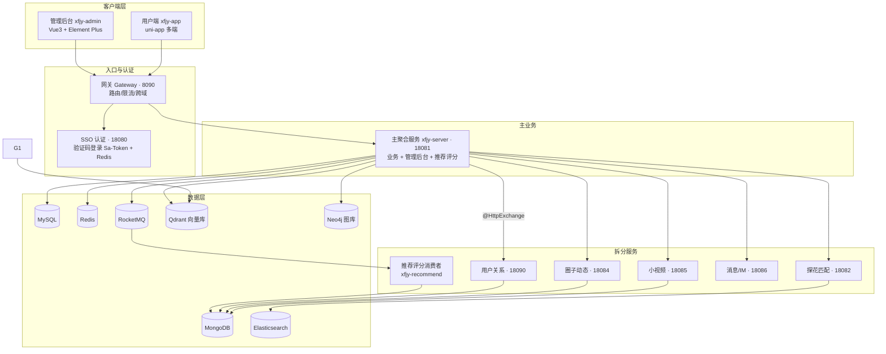

<div align="center">


**基于大数据智能推荐的陌生人社交平台**

即时通讯 · 动态圈子 · 附近的人 · 探花匹配 · 智能推荐 · VIP 权益


</div>

---

## 一、项目简介

心飞交友是一款面向年轻群体的陌生人社交平台，采用 Spring Boot 4.1 + JDK 25 微服务架构，前端覆盖 H5 / 小程序 / App 多端。

### 核心功能

| 模块 | 功能 |
|------|------|
| 📍 附近的人 | Elasticsearch Geo 地理位置搜索，按距离排序 |
| 🤝 探花匹配 | 卡片滑动（喜欢/不喜欢/超级喜欢）+ 陌生人问题破冰 |
| 📰 圈子动态 | 图文动态发布、点赞、评论、时间线 |
| 🎬 小视频 | 视频上传、推荐流、关注作者 |
| 💬 实时聊天 | 集成环信 IM，互相喜欢自动成为联系人 |
| 🤖 智能推荐 | 冷启动兜底 + ALS 协同过滤 + 地理衰减 + 画像相似度 + 互惠精排 |
| 💎 VIP 权益 | 权益矩阵驱动：超级喜欢 / 谁喜欢我 / 无限滑动 / 隐身访问 |
| 🛡️ 管理后台 | 内容审核、敏感词过滤、用户管理、数据看板 |

### 推荐引擎亮点

- **T5 冷启动**：新用户无行为数据时，地理召回（500km）+ 画像相似度（标签 Jaccard + 年龄 + 同城）兜底
- **混合评分**：ALS 分数 × 地理距离衰减 × 画像相似度 × 互惠匹配分，权重可配置，缺失维度自动降级
- **T4 互惠精排**：基于双塔 embedding 的 cosine² 双向匹配分，放大"双向高相似"候选
- **向量召回**：Qdrant 纯 REST 接入，point id = userId 免映射，不可用时自动降级
- **图推荐**：Neo4j 二度好友（共同喜欢数排序），喜欢关系实时同步
- **双塔训练**：Python + PyTorch 权重共享对称双塔，BPR loss，`--mock` 模式无需中间件验证管线

---

## 二、技术栈

### 后端

| 层次 | 技术 | 版本 |
|------|------|------|
| 语言 | JDK | 25 |
| 框架 | Spring Boot | 4.1.1 |
| 微服务 | Spring Cloud + Nacos | 2025.1.3 / 3.x |
| 网关 | Spring Cloud Gateway | 4.3.x |
| 认证鉴权 | Sa-Token | 1.46.0 |
| 持久层-关系 | MyBatis-Plus + mysql-connector-j | 3.5.17 |
| 持久层-文档 | spring-data-mongodb | SB4 托管 |
| 持久层-搜索 | spring-data-elasticsearch | SB4 托管 |
| 缓存 | Spring Cache + Lettuce Redis | SB4 托管 |
| 消息队列 | rocketmq-spring-boot-starter | 2.3.6 |
| 服务间通信 | HTTP Service Clients（@HttpExchange + RestClient） | — |
| 对象存储 | MinIO（S3 兼容） | 8.5.17 |
| 即时通讯 | 环信 IM | — |
| 向量检索 | Qdrant（纯 REST 接入） | — |
| 图数据库 | Neo4j（纯 HTTP Cypher 接入） | 5.x |
| 运行监控 | Spring Boot Actuator | health/info/metrics |
| 工具 | Lombok / commons-io / commons-codec | — |

### AI 训练工程

| 组件 | 技术 | 说明 |
|------|------|------|
| 双塔模型 | PyTorch | 权重共享对称双塔，BPR loss，64 维 L2 归一化输出 |
| 特征工程 | 自研 | tags multi-hot + age 归一化 + sex/city/edu/industry Embedding |
| 数据源 | MongoDB（user_like）+ MySQL（画像） | 行为数据 → (user, liked_user, score) 三元组 |
| 落地 | Qdrant REST upsert | point id = userId，与 Java 侧载荷完全对齐 |

### 前端

| 端 | 技术 | 说明 |
|------|------|------|
| 管理端 | Vue 3.5 + Element Plus 2.14 + ECharts + Pinia + Vite 8 + TypeScript | xfjy-admin |
| 用户端 | uni-app + Vue 3.5 + uview-plus + Pinia + vue-i18n + Sass | xfjy-app（H5 / 小程序 / App） |

---

## 三、系统架构



### 服务端口

| 服务 | 端口 | 职责 |
|------|------|------|
| xfjy-gateway | 8090 | 统一入口网关（路由/限流/跨域） |
| xfjy-sso | 18080 | 单点登录（手机号+验证码，Sa-Token + Redis） |
| xfjy-server | 18081 | 主业务聚合 + 管理后台 |
| xfjy-match-service | 18082 | 探花匹配（推荐用户/地理位置） |
| xfjy-circle-service | 18084 | 圈子动态 |
| xfjy-video-service | 18085 | 小视频 |
| xfjy-message-service | 18086 | 消息/IM（环信集成） |
| xfjy-user-service | 18090 | 用户关系（好友/喜欢/访客） |
| xfjy-recommend | — | RocketMQ 评分消费者 |
| xfjy-elasticsearch | — | ES Geo 附近的人 |
| xfjy-pay-service | 18089 | 支付/VIP 权益 |

**数据链路**：用户行为 → xfjy-server → RocketMQ → xfjy-recommend → MongoDB 评分 → 推荐接口混合评分 → 前端消费。

**网关路由**：仅做边缘路由（sso + xfjy-server）。拆分服务由 xfjy-server 经 @HttpExchange 内部直连，不经网关。

---

## 四、项目结构

```
xfjy/
├── pom.xml                     # 根 pom：SB 4.1.1 parent + 依赖版本集中管理
├── xfjy-gateway/               # 统一入口网关（8090，Spring Cloud Gateway）
├── xfjy-sso/                   # 认证服务（18080，验证码登录，Sa-Token + Redis）
├── xfjy-server/                # 主业务聚合服务（18081，边缘入口 + 管理后台）
├── xfjy-user-service/          # 用户关系服务（18090，Mongo：好友/喜欢/访客）
├── xfjy-match-service/         # 探花匹配服务（18082，推荐用户/地理位置）
├── xfjy-circle-service/        # 圈子动态服务（18084，动态/评论/时间线）
├── xfjy-video-service/         # 小视频服务（18085，视频/关注作者）
├── xfjy-message-service/       # 消息/IM 服务（18086，环信集成）
├── xfjy-pay-service/           # 支付/VIP 权益服务（18089）
├── xfjy-recommend/             # 推荐评分消费者（RocketMQ → MongoDB）
├── xfjy-elasticsearch/         # ES Geo 地理位置：附近的人
├── xfjy-api/                    # 内部 HTTP 接口契约（@HttpExchange）
├── xfjy-admin/                 # 管理后台前端（Vue3 + Element Plus + Vite 8）
├── xfjy-app/                   # 用户端前端（uni-app：H5/小程序/App）
├── docs/                       # 需求文档、数据库脚本、logo
└── scripts/                    # 部署/验证脚本（不入库）
```

---

## 五、快速开始

### 环境要求

| 依赖 | 版本 | 说明 |
|------|------|------|
| JDK | 25 | 后端编译运行 |
| Maven | 3.9+ | 后端构建 |
| Node.js | 22+ | 前端构建 |
| Python | 3.11+ | 双塔训练（可选） |
| MySQL | 8.0 | 关系数据 |
| Redis | 7.x | 缓存/会话 |
| MongoDB | 8.0 | 动态/关系/评分 |
| Elasticsearch | 8.x | 地理搜索 |
| RocketMQ | 5.x | 行为消息 |
| Nacos | 3.x | 服务注册/配置 |

> Qdrant / Neo4j 为可选中间件，未部署时推荐引擎自动降级，不阻断主链路。

### 后端启动

```bash
# 1. 初始化数据库（全量脚本：表结构+初始数据，一键导入）
mysql -u root -p --default-character-set=utf8mb4 -e "CREATE DATABASE IF NOT EXISTS xfjy DEFAULT CHARSET utf8mb4;"
mysql -u root -p --default-character-set=utf8mb4 xfjy < scripts/mytanhua.sql

# 2. 编译
mvn clean compile

# 3. 启动（按顺序）
# Nacos → MySQL → Redis → MongoDB → ES → RocketMQ
# 然后：sso → server → gateway → 各拆分服务
```

### 前端启动

```bash
# 管理后台
cd xfjy-admin && npm install && npm run dev

# 用户端 H5
cd xfjy-app && npm install && npm run dev:h5
```

---

## 六、环境变量配置

所有敏感配置通过环境变量注入，模板见 [.env.example](.env.example)。

### 基础中间件

| 变量 | 说明 | 默认值 |
|------|------|--------|
| NACOS_SERVER_ADDR | Nacos 地址 | 127.0.0.1:8848 |
| NACOS_USERNAME | Nacos 用户名 | nacos |
| NACOS_PASSWORD | Nacos 密码 | （空） |
| MYSQL_URL | MySQL 连接串 | 127.0.0.1:3306/xfjy |
| MYSQL_PASSWORD | MySQL 密码 | （空） |
| REDIS_HOST | Redis 地址 | 127.0.0.1 |
| REDIS_PASSWORD | Redis 密码 | （空） |
| MONGO_URI | MongoDB 连接串 | 127.0.0.1:27017/xfjy |
| ROCKETMQ_NAME_SERVER | RocketMQ NameServer | 127.0.0.1:9876 |

### 第三方服务

| 变量 | 说明 |
|------|------|
| SMS_ACCESS_KEY_ID / SECRET | 阿里云短信 |
| MINIO_ENDPOINT / ACCESS_KEY_ID / ACCESS_KEY_SECRET / BUCKET / URL_PREFIX | MinIO 对象存储（minio.properties） |
| BAIDU_FACE_API_KEY / SECRET_KEY | 百度 AI 人脸 |
| EASEMOB_CLIENT_ID / SECRET | 环信 IM |
| NEO4J_PASSWORD | Neo4j 密码 |

> 未配置的第三方服务走占位/模拟模式，开发环境可用。

---

## 七、监控与持续集成

### 运行监控（Actuator）

xfjy-server 集成 Spring Boot Actuator，暴露以下端点（无需认证）：

| 端点 | 说明 |
|------|------|
| `GET /actuator/health` | 健康检查（含 DB/Redis/Mongo 等组件状态） |
| `GET /actuator/info` | 应用信息 |
| `GET /actuator/metrics` | 指标列表及明细 |

```bash
# 健康检查示例
curl http://127.0.0.1:18081/actuator/health
# 预期: {"status":"UP"}
```

### CI 流水线

[.github/workflows/ci.yml](.github/workflows/ci.yml) 定义三条并行 Job：

| Job | 内容 | 环境 |
|-----|------|------|
| backend | `mvn compile` 全量编译 | JDK 25 |
| admin | 管理后台 `npm run build` | Node 22 |
| app | 用户端 `npm run build:h5` | Node 22 |

触发条件：push / PR 到 master 分支。

---

## 八、文档

- 📄 [需求文档](docs/需求文档.md)
- 🗄️ 数据库脚本：本地 `scripts/mytanhua.sql`（全量表结构 + 初始数据，一键导入，不入库）

---

## 九、贡献指南

1. Fork 本仓库
2. 创建特性分支：`git checkout -b feat/your-feature`
3. 提交改动：`git commit -m "feat: 简述"`
4. 推送分支：`git push origin feat/your-feature`
5. 提交 Pull Request

### 开发规范

- commit message 格式：`type: 简述`（feat / fix / refactor / docs / test / chore / perf）
- 密钥/凭证禁止入库，统一环境变量外置（`.env.example` 为模板）
- 改动 `xfjy-api` 后须 `mvn -am` 连带构建

---

## 十、License

[MIT](LICENSE)

---

<div align="center">
<sub>Built with ❤️ by itxinfei</sub>
</div>